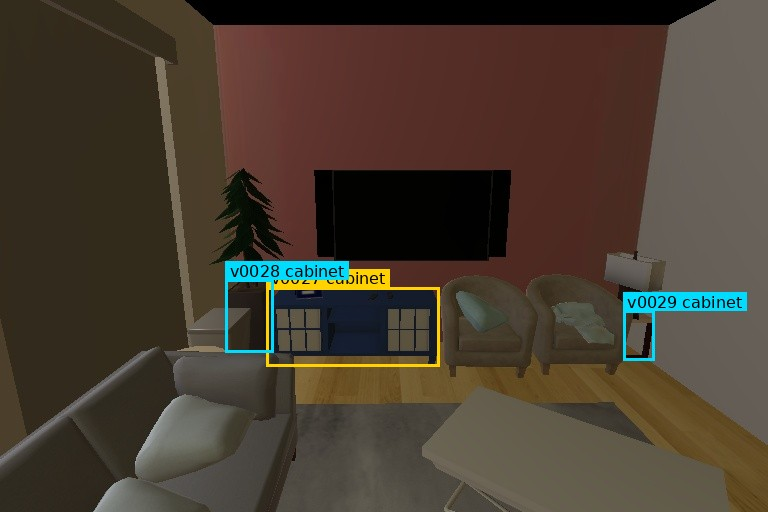
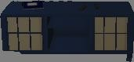

# 一次真实 VLM 调用：蓝色柜子 v0027

来源运行：`web_visual_20261106_134404_686145`；调用编号：`0004`。

这是历史调用的直接导出，没有重新请求模型，也没有用当前代码重建输入。

用户原任务是“去蓝色柜子旁边”。本次视觉核实实际收到的任务字段见下方 JSON；原指令不一定逐字出现在该次请求中。

## 1. 系统提示词（原文）

```text
核实黄色框候选，同时留意全图中更符合任务的物体。青色框为其他候选，框上ID与visible_candidates对应。类别标签不是事实。判断目标类别、主体颜色/属性是否符合；遮挡不等于类别错误，可以结合历史清晰图理解物体，但不能用历史图替代当前到达确认。光照、遮挡或画面不清时回答unknown，不猜测。无属性要求时attributes_match=yes。返回JSON：{"candidate_id":"指定ID","observation_id":"当前观测ID","category_match":"yes|no|unknown","attributes_match":"yes|no|unknown","reason":"可见依据", "approach_recommended":false, "target_hint":null}。如果能明确辨认类别或目标属性，值得靠近核实另一项，approach_recommended可为true，并说明具体依据；仅有模糊暗块、类别和属性都unknown时不要建议直接靠近；明确不符时不能建议靠近。如果别的框更明确符合目标，target_hint返回{"candidate_id":"该框ID","category_match":"yes","attributes_match":"yes","reason":"具体位置和可见依据"}。不要只在reason里提到其他目标，要填写target_hint。只推荐当前可见且未excluded的ID，不得编造ID。
```

## 2. 用户消息（严格按原始内容顺序）

### 内容块 1

```json
{
  "observation_id": "obs_00025",
  "candidate_id": "v0027",
  "detected_category": "cabinet",
  "target_categories": [
    "cabinet"
  ],
  "attributes": [
    "blue"
  ],
  "identity_state": "tentative",
  "visible_candidates": [
    {
      "id": "v0027",
      "detected_category": "cabinet",
      "bbox": [
        266.75970458984375,
        287.0616455078125,
        439.29095458984375,
        366.02911376953125
      ],
      "excluded": false
    },
    {
      "id": "v0028",
      "detected_category": "cabinet",
      "bbox": [
        225.81930541992188,
        279.9868469238281,
        273.76739501953125,
        352.9314880371094
      ],
      "excluded": false
    },
    {
      "id": "v0029",
      "detected_category": "cabinet",
      "bbox": [
        623.068603515625,
        310.91839599609375,
        654.6614379882812,
        360.19091796875
      ],
      "excluded": false
    }
  ],
  "excluded_previous_id": null
}
```

### 内容块 2

```text
Current scene. Yellow box identifies candidate v0027; detected category: cabinet (detector hypothesis, verify visually).
```

### 内容块 3



### 内容块 4

```text
Current candidate v0027 from obs_00025
```

### 内容块 5



## 3. 模型输出（原文）

```json
{
  "candidate_id": "v0027",
  "observation_id": "obs_00025",
  "category_match": "yes",
  "attributes_match": "yes",
  "reason": "The object in the yellow box is clearly a low cabinet or media console situated under a wall-mounted screen. It has a distinct dark blue frame/body with lighter grid-patterned doors, matching the 'cabinet' category and 'blue' attribute requirement.",
  "approach_recommended": false,
  "target_hint": null
}
```

## 4. 调用统计

```json
[
  {
    "call": 4,
    "backend": "openai",
    "model": "qwen3.8-max",
    "image_count": 2,
    "phase": "decision",
    "ok": true,
    "usage": {
      "completion_tokens": 123,
      "completion_tokens_details": {
        "text_tokens": 123
      },
      "prompt_tokens": 1155,
      "prompt_tokens_details": {
        "cached_tokens": 0,
        "image_tokens": 460,
        "text_tokens": 695
      },
      "total_tokens": 1278
    },
    "finish_reason": "stop",
    "wall_seconds": 3.2056326046586037
  }
]
```

## 文件说明与边界

- `request_original.json`：原始日志，含实际发送图片的 Base64。
- `request_readable.json`：同样的消息顺序，图片 Base64 替换为本地文件路径，仅供阅读。
- `response_original.json`：服务端完整返回；`model_output.txt` 是模型回答原文。
- `images/`：直接解码请求内图片，没有重新绘图或压缩。
- `manifest.json`：来源和 SHA-256 校验值。
- 请求日志保存 system/content，不是完整 HTTP 报文；不包含密钥或请求头。
- 这是视觉判断调用，不是到达成功证明；模型判断与程序后续移动是两个环节。
